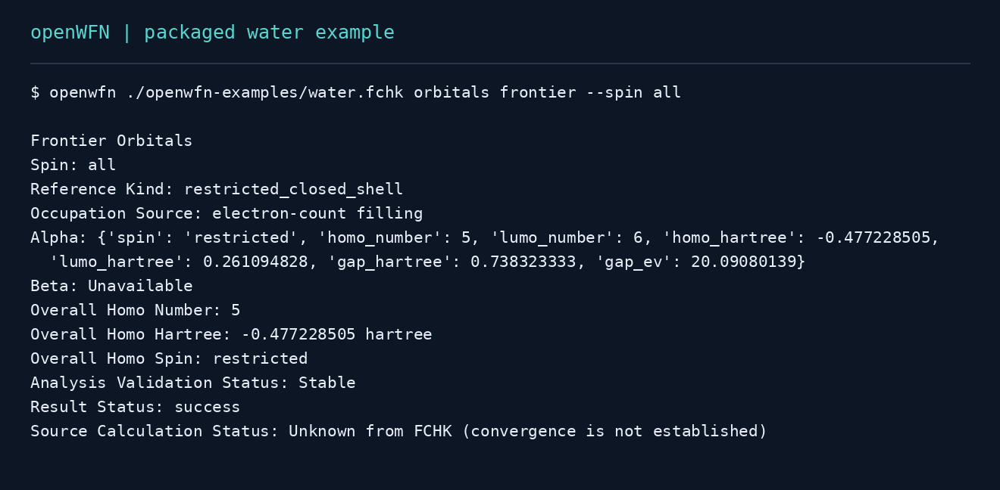
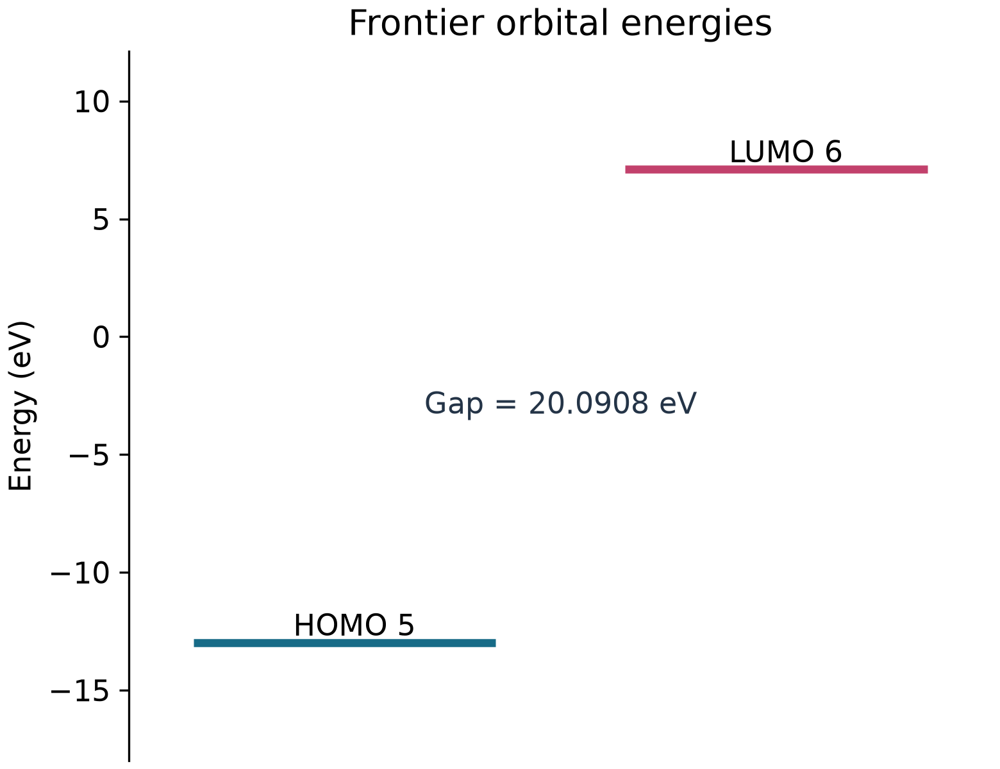

<div align="center">


### Wavefunction analysis, made reproducible.

**Wavefunction analysis for computational chemistry.**

Inspect molecular structure, orbitals, electron density and supported calculation properties<br>
through a CLI, Python API, batch workflows, local chat or MCP.

[](https://pypi.org/project/openwfn/)
[](https://github.com/sha786muhammed/openWFN/actions/workflows/tests.yml)
[](https://pypi.org/project/openwfn/)
[](LICENSE)

[Quick start](#quick-start) · [Example output](#see-the-output) · [Capabilities](#what-you-can-analyze) · [Documentation](https://sha786muhammed.github.io/openWFN/) · [Contribute](#contribute)

</div>

**openWFN** is a Python toolkit for wavefunction analysis and quantum-chemistry post-processing. Load a supported file, check which analyses its data allow, and obtain results with units, warnings and source provenance. Use the same scientific engine for individual calculations or collections of files. Reports and the offline workbench are optional exports.

## Quick start

Use Python 3.10–3.13 in a separate environment. The standard installation includes the file readers, Python API, terminal chat and local MCP server.

```bash
python -m pip install --upgrade openwfn
openwfn examples install ./openwfn-examples
openwfn ./openwfn-examples/water.fchk summary
openwfn ./openwfn-examples/water.fchk orbitals frontier --spin all
```

To explore the example through guided menus:

```bash
openwfn ./openwfn-examples/water.fchk
```

For your own calculation, inspect its available data first:

```bash
openwfn molecule.molden capabilities
openwfn molecule.molden summary
```

File support and analysis availability are different: a structure file does not contain a wavefunction, and a calculation output may contain only selected properties.

[Installation and environments](docs/installation.md) · [Your first analysis](docs/start/first-analysis.md) · [Troubleshooting](docs/guides/troubleshooting.md)

## See the output

The following examples are generated from the packaged `water.fchk` fixture. They illustrate this calculation, rather than establish accuracy for other systems.





Create the plot and a standalone molecular workbench yourself:

```bash
openwfn ./openwfn-examples/water.fchk plot frontier water-frontier.png
openwfn ./openwfn-examples/water.fchk workbench water-workbench.html --open
```

The workbench opens as one offline HTML file for exploring molecular structure and available results. Keep numerical JSON or CSV records alongside it. [Workbench guide and interface scope](docs/workbench.md) · [Example provenance and reproduction](docs/guides/readme-examples.md)

## What you can analyze

| Area | Available workflows | Important boundary |
| --- | --- | --- |
| Structure | Distances, angles, dihedrals, connectivity and fragments | Geometry-based connectivity is not a calculated bond order. |
| Orbitals | Frontier energies, orbital composition, MO cubes, DOS and PDOS | Requires compatible orbital, basis and overlap data for the selected method. |
| Populations and bonding | Mulliken, Löwdin and Hirshfeld populations; Mayer bond orders | Method conventions and validation scope differ; native Hirshfeld evidence covers the documented H/C/N/O all-electron cases. |
| Density and ESP | Electron-density evaluation, integration, grids and point electrostatic potential | Numerical settings need convergence checks for your system. |
| Spectroscopy and excited states | Supported vibrational records, IR/Raman-activity profiles, excited-state records, UV–Vis and NTO workflows | Experimental; requires the corresponding source records and supported conventions. |
| Real-space descriptors | ELF, LOL, NCI/RDG and bounded QTAIM critical-point searches | Experimental; QTAIM basin integration and atomic basin charges are not included. |

Availability depends on the data in the input. Read the [method-specific validation evidence](docs/science/validation-status.md) and [limitations](docs/limitations.md) before interpreting results.

### Supported inputs

| Input family | Formats | What the file can supply |
| --- | --- | --- |
| Wavefunctions | `.fchk`, `.fch`, `.molden`, `.molden.input`, `.wfn`, `.wfx`, `.mwfn`, `.mkl` | Structure and electronic data, depending on the producer and file contents. |
| Volumetric grids | `.cube`, `.cub` | A stored field, axes and units; not a complete wavefunction. |
| Calculation outputs | Gaussian, ORCA and Q-Chem `.log` / `.out` | Supported source-reported properties and spectroscopy records. |
| Structures | `.xyz`, `.pdb`, `.mol`, `.sdf` | Atomic structure and supported formal-charge records; no inferred electronic structure. |

Gaussian `.chk` is a proprietary binary format and requires Gaussian's separately installed `formchk` utility; pip does not supply it. See the [format reference](docs/reference/formats-and-exports.md) for reader-specific support and restrictions.

## Choose your workflow

| Workflow | Start here |
| --- | --- |
| Guided interface | `openwfn molecule.molden` |
| Direct CLI | `openwfn molecule.molden orbitals frontier --spin all` |
| Terminal chat | `openwfn molecule.molden chat` |
| Batch analysis | `openwfn batch ./calculations --analyses summary,frontier --output-dir ./results` |
| Python | `load()` a calculation and call the same analysis engine; see below. |
| MCP | Connect a client to the local stdio server using the [MCP guide](docs/mcp.md). |

### Python

```python
from openwfn import load

calculation = load("openwfn-examples/water.fchk")
result = calculation.orbitals(spin="all")
print(result.as_dict())
```

Use `calculation.capabilities()` to inspect the data available in another file. [Python API reference](docs/reference/python-api.md)

### Chat and AI clients

Supported short file questions, such as “What is the HOMO–LUMO gap?”, run locally through openWFN. General conversation and other model-planned questions require a separately configured model. openWFN does not download model weights automatically.

```bash
openwfn ./openwfn-examples/water.fchk chat
```

Within chat, `/inspect` shows available analyses, `/details` shows diagnostics and provenance, and `/record` shows the complete last scientific result. Use `/connect` to configure a model connection. MCP exposes the local scientific tools to a compatible client; it is a separate interface from terminal chat.

[Assistant setup and privacy](docs/assistant.md) · [MCP setup](docs/mcp.md)

## Scientific scope and reproducibility

Scientific values come from the analysis engine. Model-generated explanations require separate verification. Missing data remain unavailable, and successful execution does not establish source convergence or universal numerical accuracy.

| Status | Meaning |
| --- | --- |
| Stable | Supported interface with tests for expected behavior. |
| Validated | Compared against defined invariants or reference expectations for the named cases and tolerances. |
| Experimental | Available for investigation; evidence is not broad enough for routine research claims. |
| Unsupported | Required data, method or verification is absent. |

Population analysis uses source-reported effective nuclear charges for ECP and ghost centers; conservation failures return partial results with warnings. Direct density integration starts at 0.15 bohr spacing; check convergence for your chosen spacing and padding.

Keep the input checksum, software version, settings and complete result with your research. Global `--format json` selects structured CLI output:

```bash
openwfn --format json ./openwfn-examples/water.fchk orbitals frontier --spin all
```

[Validation evidence](docs/science/validation-status.md) · [Methods and limitations](docs/limitations.md) · [CLI reference](docs/reference/cli.md)

## Contribute

Contributions are welcome from computational chemists, Python developers and users trying openWFN on real calculations. Useful starting points include reproducing an example, improving a tutorial, reporting a parser failure or comparing a documented method against an independent reference.

For a proposed feature or collaboration, [open an issue](https://github.com/sha786muhammed/openWFN/issues/new/choose) with the scientific problem, a minimal shareable example and the result you need. Please discuss a new scientific method before starting a large implementation.

[Contribution guide](CONTRIBUTING.md) · [Scientific discrepancy report](https://github.com/sha786muhammed/openWFN/issues/new?template=scientific-discrepancy.yml) · [Maintainers](MAINTAINERS.md)

## Citation and license

Cite the exact version used in your work; citation metadata are available in [CITATION.cff](CITATION.cff). Project code is distributed under the [MIT License](LICENSE). Dependency and example-data terms are listed in [third-party notices](THIRD_PARTY_NOTICES.md).

[Documentation](https://sha786muhammed.github.io/openWFN/) · [Examples](examples/) · [Release history](CHANGELOG.md) · [Releases](https://github.com/sha786muhammed/openWFN/releases)
