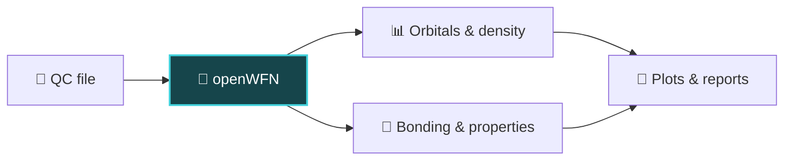
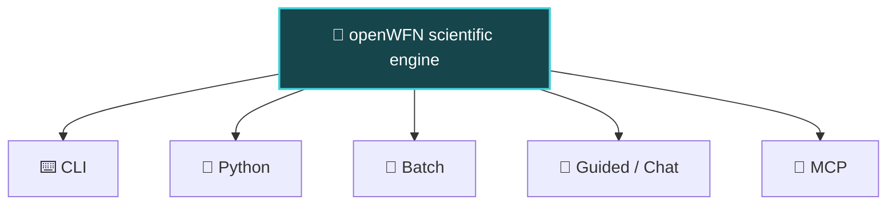

<div align="center">


### Wavefunction analysis, made reproducible.

**One scientific engine. From quantum-chemistry files to meaningful results.**

[](https://pypi.org/project/openwfn/) [](https://github.com/sha786muhammed/openWFN/actions/workflows/tests.yml) [](LICENSE)

[Get started](#get-started) · [What it does](#what-can-openwfn-do) · [Ways to use it](#choose-your-workflow) · [Validation](docs/science/validation-status.md) · [Docs](https://sha786muhammed.github.io/openWFN/)

</div>

## What is openWFN?

**openWFN** is a wavefunction and quantum-chemistry post-processing toolkit. Explore electronic structure without juggling separate scripts for every analysis. Load a supported calculation file, inspect available data, run scientific analyses, and export results.

Use it for individual calculations or collections. CLI, Python, batch, MCP and chat use the same analysis engine. Reports and the offline workbench are optional exports.



## What can openWFN do?

| 🧬 Structure | ⚛️ Orbitals | 🌐 Electron density |
|:--|:--|:--|
| Distances, angles, bonds | HOMO/LUMO, MO composition, DOS/PDOS | Density checks, ESP, cube grids |
| **🔗 Bonding** | **📈 Spectra & visualization** | **🧪 Advanced methods** |
| Mulliken/Löwdin/Hirshfeld populations, Mayer bond orders | Supported IR/Raman and UV–Vis records, plots, reports | NTO, ELF, LOL, NCI, QTAIM critical points* |

Availability depends on the data in your file. Some methods are experimental or validated only within a defined scope; QTAIM basin integration is not included. See [methods and limitations](docs/limitations.md).

### Supported files

| Input family | Formats |
|:--|:--|
| Wavefunctions | `.fchk`, `.fch`, `.molden`, `.molden.input`, `.wfn`, `.wfx`, `.mwfn`, `.mkl` |
| Grids | `.cube`, `.cub` |
| Calculation outputs | Gaussian, ORCA and Q-Chem `.log` / `.out` |
| Structures | `.xyz`, `.pdb`, `.mol`, `.sdf` |

Binary `.chk` is a proprietary binary format. It needs Gaussian's separately installed `formchk` utility; pip does not supply it. A structure or output file does not necessarily contain a complete wavefunction. Check [supported formats](docs/reference/formats-and-exports.md) for details.

## Get started

Requires Python 3.10 or newer.

```bash
python -m pip install --upgrade openwfn
openwfn examples install ./openwfn-examples
openwfn ./openwfn-examples/water.fchk summary
openwfn ./openwfn-examples/water.fchk orbitals frontier --spin all
```

**Try the guided interface:** `openwfn ./openwfn-examples/water.fchk`

**Use your own file:**

```bash
openwfn molecule.molden capabilities
openwfn molecule.molden summary
```

The normal installation includes file readers, the Python API, local MCP and terminal chat. Model weights, Gaussian utilities and public servers are not installed automatically. See the [installation guide](docs/installation.md).

## Choose your workflow



| If you want to… | Start here |
|:--|:--|
| Explore a file interactively | `openwfn molecule.molden` |
| Ask questions about a file | `openwfn molecule.molden chat` |
| Analyze many files | `openwfn batch ./calculations --analyses summary,frontier --output-dir ./results` |
| Build a Python workflow | [Python API](docs/reference/python-api.md) |
| Connect an AI client to tools | [MCP guide](docs/mcp.md) |

For general conversation and model-generated explanations, connect an existing model using the [assistant setup guide](docs/assistant.md). openWFN does not download a model automatically. The MCP server runs locally over stdio and requires an MCP client.

## Research results should be verifiable

Scientific values come from the analysis engine, not language-model guesses. Results retain units, warnings, validation status and source provenance. Missing data are reported as unavailable.

Population analysis uses source-reported effective nuclear charges for ECP and ghost centers; conservation failures return partial results with warnings. Direct density integration starts at 0.15 bohr spacing; you still need to check convergence.

Check the method-specific [validation status](docs/science/validation-status.md) before using results in research. Density integration needs a convergence check for your chosen spacing and padding; a successful command alone does not establish numerical accuracy. Chat-generated explanations also require verification.

Keep the input checksum, software version, settings and complete result with your work. Use `--format json` for structured results; see the [CLI reference](docs/reference/cli.md).

<div align="center">

[📖 Documentation](https://sha786muhammed.github.io/openWFN/) · [🧪 Examples](examples/) · [📋 Supported formats](docs/reference/formats-and-exports.md) · [🤝 Contribute](CONTRIBUTING.md) · [📝 Cite](CITATION.cff)

**MIT licensed · open source**

Dependency and example-data terms are listed in [third-party notices](THIRD_PARTY_NOTICES.md).

</div>
